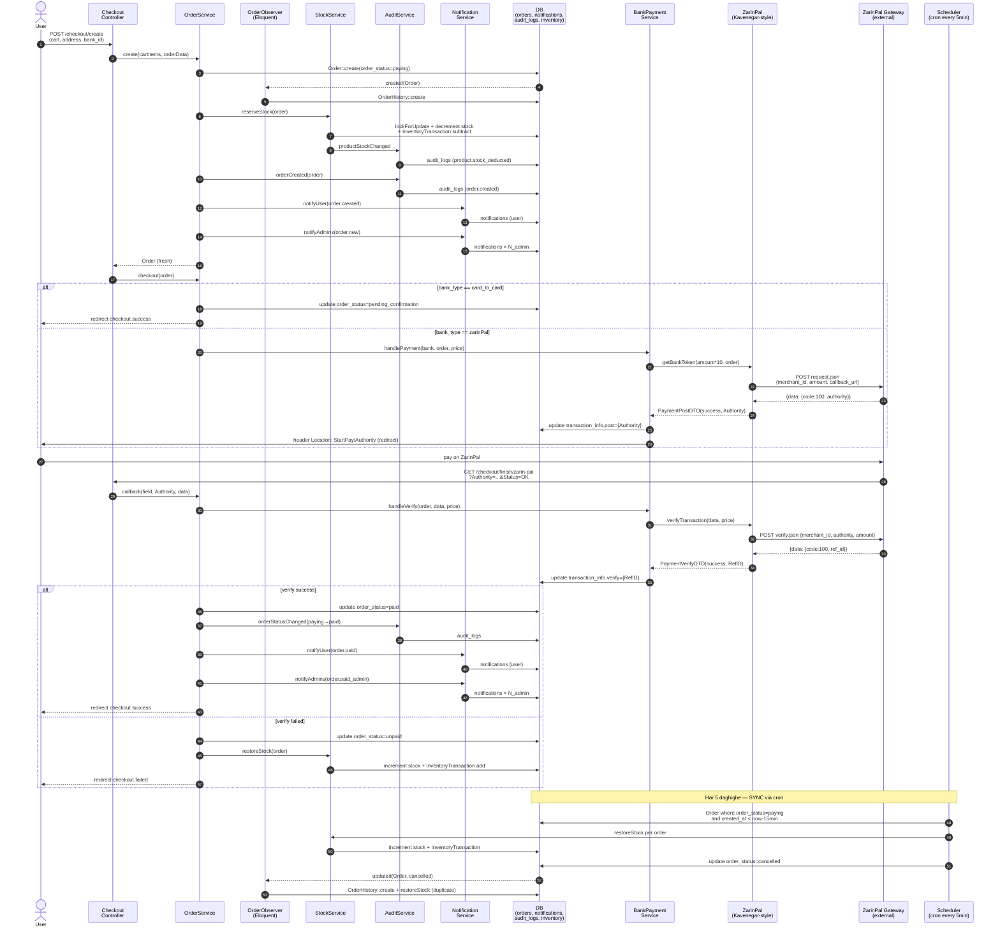

# Async & Events — Overview

> **Source of Truth:** `app/Events/`, `app/Listeners/`, `app/Jobs/`, `app/Providers/EventServiceProvider.php`, `app/Console/Kernel.php` dar project **vojoud nadarand** (audit 2026-09-04). `config/queue.php` default `database` vali hich `dispatch()` vojoud nadarad. Tamam-e flow-ha **SYNC EXECUTION** dar request lifecycle ejra mishavand. `routes/console.php` tanha schedule-e fe'li ra negah midarad.

## Execution Mode — Kolle Project

| Layer | Mode | Evidence |
|-------|------|----------|
| Events / Listeners | ❌ Vojoud nadarad — `event()` 0 hit | `app/Events` / `app/Listeners` not found |
| Jobs / Queues | ❌ Vojoud nadarad — `ShouldQueue` 0 hit | `app/Jobs` not found, `dispatch(` 0 hit |
| Observers | ✅ 1 observer — `OrderObserver` | `AppServiceProvider::boot() → Order::observe` |
| Scheduler | ✅ 1 job — `orders:cancel-expired` | `routes/console.php → everyFiveMinutes` |
| Notifications (DB) | ✅ SYNC — `Notification::create` | `NotificationService` — hich queue |
| SMS (Kavenegar) | ✅ SYNC — cURL mostaghim | `Sms::sendLookup` — timeout 30s |

## File Map — 4 Document-e Modular + 1 Overview

| File | Mohtava |
|------|---------|
| [`events-listeners.md`](./events-listeners.md) | Map-e kamel-e har dispatch-e manteghhi (OrderCreated, PaymentVerified, Otp, Contact, Review, Shipping) — payload, listener, table, sequence |
| [`jobs-queues.md`](./jobs-queues.md) | Queue config (`database`, `retry_after=90`), har job-e manteghhi be surat SYNC service call + handle/failed logic, rahnameye async kardan |
| [`commands-schedule.md`](./commands-schedule.md) | 2 command (`CancelExpiredOrders`, `LangNew`), `routes/console.php` schedule (`*/5 * * * *` + `0 * * * *`), crontab, timing gotcha |
| [`notifications.md`](./notifications.md) | Channel-ha (DB ✅, SMS OTP ✅, Mail ❌), `NotificationService::TYPES` (11 type), `Sms` helper (4 method), OTP flow, template tokens |
| `async-and-events.md` (in file) | Overview + Mermaid sequence diagram-e Order Creation & Payment Flow |

## Mermaid — Order Creation & Payment Flow (SYNC)

> Hame step-ha SYNC EXECUTION hastand — hich queue nist. Agar Vibe Coding job async ezafe konad, in diagram be `queue` lane taghir mikonad.

### Khanesh-e Diagram baraye Vibe Coding

- **Hame arrow-ha SYNC** — hich `queue` lane vojoud nadarad. Har `->DB` yek `INSERT/UPDATE` dar haman request ast.
- **Side-effect-ha faramoosh nashavad:** bad az `Order::create` hatman `reserveStock` + `orderCreated` + 2 notification. Bad az `paid` hatman `orderStatusChanged` + 2 notification. Bad az `failed/unpaid` hatman `restoreStock`.
- **Scheduler joda:** `CancelExpiredOrders` kharej az request lifecycle — via `php artisan schedule:run` har 5min. Avg 17.5min delay ta cancel (gotcha dar `commands-schedule.md`).
- **OTP joda:** `OtpService::send` → `WelcomeDiscountService` + `discount.welcome` notification + `Sms::sendLookup` — hame SYNC dar `POST /otp/send`.

## Che Chizi Queue Nist — Va Che Bayad Queue Shavad

| Alan SYNC | Pishnahad Queue (ayande) |
|-----------|--------------------------|
| `NotificationService::notifyUser/Admins` — DB insert | `SendNotificationJob` on `notifications` queue — 3 tries, backoff 10/30/60s |
| `Sms::sendLookup` — cURL 30s | `SendOtpSmsJob` on `sms` queue — timeout 30s, retry 3 |
| `AuditService::log` — DB insert | mitavan sync mand — sari va mohem |
| `StockService::reserve/restore` | **nabayad async** — bayad dar transaction-e asli bemanad (lockForUpdate) |

Tafsil-e queue config va failed strategy dar [`jobs-queues.md`](./jobs-queues.md) — section 4 va 5.
